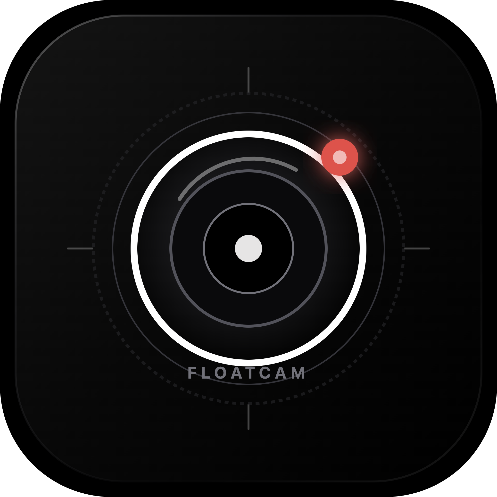

<div align="center">



# FloatCam

**Use a phone camera as a floating wireless webcam preview on a desktop.**

[](https://github.com/ydvkundan2005/FloatCam/actions/workflows/build.yml)
[](LICENSE)
[](docs/PACKAGING.md)
[](package.json)

[Website](https://ydvkundan2005.github.io/FloatCam) · [Releases](https://github.com/ydvkundan2005/FloatCam/releases) · [Issues](https://github.com/ydvkundan2005/FloatCam/issues)

</div>

## Overview

FloatCam is an Electron desktop application for macOS and Windows. It connects a phone browser to a desktop receiver so the phone camera can appear in a small, always-on-top floating preview window.

The phone-side client runs in a modern mobile browser. A local Node.js HTTPS server serves the client and coordinates WebRTC session setup over a WebSocket signalling channel. The application includes a desktop control panel and a separate preview window.

## Engineering scope

- **Desktop application:** Electron main process, renderer windows and preload bridges.
- **Signalling:** Node.js HTTPS and WebSocket server for session setup.
- **Media:** WebRTC peer connection between the mobile browser and desktop receiver.
- **Phone client:** HTML, CSS and JavaScript using browser camera APIs.
- **Desktop interaction:** Floating, transparent preview; window shapes; zoom, opacity and positioning controls.
- **Packaging:** Build scripts and installer configuration for macOS DMG and Windows distributions.

## Architecture

```text
Phone browser (camera)
        |
        | HTTPS / WebSocket signalling
        v
Local Node.js signalling server
        |
        | WebRTC session negotiation
        v
Electron desktop application
   |                 |
Control panel    Floating preview
```

The main code areas are:

| Path | Responsibility |
|---|---|
| `main.js` | Electron lifecycle, windows, tray and IPC coordination |
| `lib/` | Local HTTPS/WebSocket signalling, certificates, network and settings |
| `phone/` | Mobile browser camera client |
| `renderer/` | Desktop control and preview interfaces |
| `shared/` | Shared IPC channel and shape definitions |
| `preload-*.js` | Narrow APIs exposed to renderer processes |
| `tests/` | Node.js tests for selected modules |
| `docs/` | Architecture, security, packaging and troubleshooting notes |

See [Architecture](docs/ARCHITECTURE.md) for component details.

## Run locally

**Requirements:** Node.js 18 or later and npm.

```bash
git clone https://github.com/ydvkundan2005/FloatCam.git
cd FloatCam
npm ci
npm start
```

The phone and desktop should be connected to a network that permits local device communication. Camera access requires a browser secure context; review the setup instructions and certificate notes before connecting a device.

## Tests and continuous integration

Run the available automated tests with:

```bash
npm test
```

The repository includes tests for selected modules such as certificate management, IPC channel definitions, local IP handling, port management, session isolation, settings persistence and window-shape definitions.

The [GitHub Actions workflow](.github/workflows/build.yml) is configured to run the test command on multiple operating systems and Node.js versions, and to build macOS and Windows artifacts. The badge above links to the actual workflow history; consult the latest run rather than treating the workflow's existence as proof that every build currently passes.

The current test suite is unit-level coverage of selected modules. It does not represent complete end-to-end coverage of Electron windows, camera permissions, WebRTC behavior or every device/browser combination.

## Security and limitations

- The project is designed around local-network use; network locality alone does not guarantee confidentiality.
- Review the certificate trust steps and the security model before connecting devices on an untrusted network.
- Electron renderer isolation, preload boundaries and content-security-policy details are documented in [Security](docs/SECURITY.md).
- The codebase audit records dependency risks for the current Electron and certificate-related dependencies. Revisit those risks and update dependencies before treating a build as suitable for sensitive use.
- No measured latency benchmark is published in this repository. Performance statements should be based on reproducible measurements on specified devices and network conditions.

## Build distributables

```bash
npm run build:mac
npm run build:win
```

See [Packaging](docs/PACKAGING.md) for platform-specific details. Check the [Releases page](https://github.com/ydvkundan2005/FloatCam/releases) for published artifacts and version-specific notes.

## Documentation

- [Architecture and data flow](docs/ARCHITECTURE.md)
- [Security model](docs/SECURITY.md)
- [Development workflow](docs/DEVELOPMENT.md)
- [Packaging](docs/PACKAGING.md)
- [Install guide](docs/INSTALL-GUIDE.md)
- [Troubleshooting](docs/TROUBLESHOOTING.md)
- [Codebase audit](docs/audit/CODEBASE_AUDIT.md)
- [Error register](docs/audit/ERROR_REGISTER.md)

## License

Released under the [MIT License](LICENSE).
