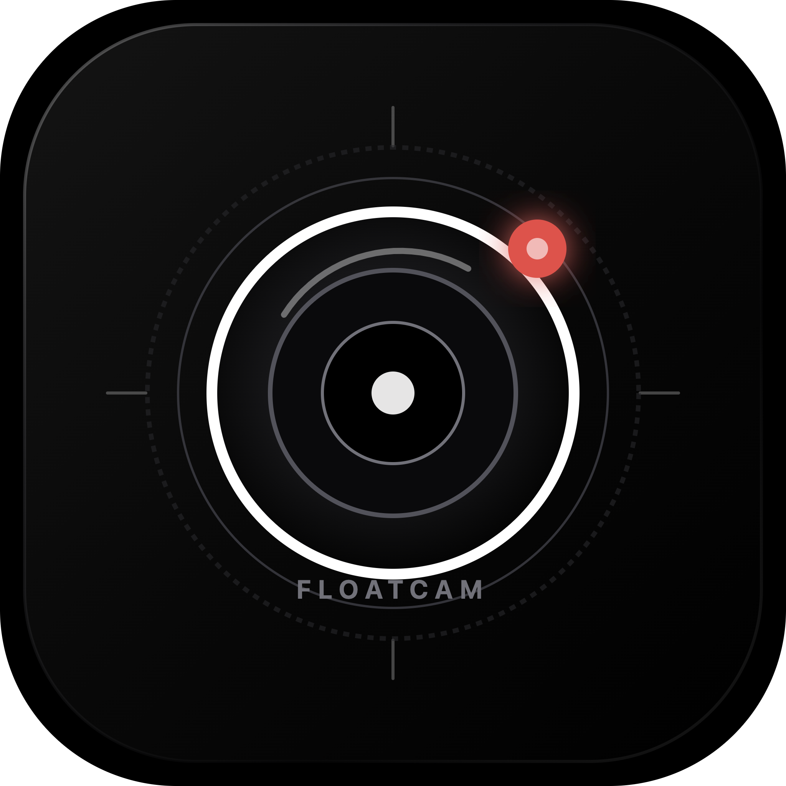

<div align="center">



# FloatCam

**Turn your smartphone into a wireless, floating desktop webcam.**  
Sub-second WebRTC latency · 100% private · Zero cloud · Free & Open Source

[](LICENSE)
[](docs/PACKAGING.md)
[](package.json)
[](package.json)
[](https://github.com/ydvkundan2005/FloatCam/releases/tag/v3.0)

**[🌐 Website](https://ydvkundan2005.github.io/FloatCam)** · **[⬇ Download for Mac](https://github.com/ydvkundan2005/FloatCam/releases/download/v3.0/FloatCam-v3.dmg)** · **[⬇ Download for Windows](https://github.com/ydvkundan2005/FloatCam/releases/download/v3.0/FloatCam-Setup-v3.exe)** · **[📋 All Releases](https://github.com/ydvkundan2005/FloatCam/releases)**

</div>

---

## 🌟 What is FloatCam?

FloatCam is a free, open-source Electron app that lets you use your **iPhone or Android phone as a wireless webcam** on your Mac or Windows PC — with zero cloud dependencies and sub-second latency.

Your phone's camera streams directly to a beautiful **always-on-top floating window** on your desktop via WebRTC over your local Wi-Fi. No apps to install on your phone. No accounts. No data leaves your network.

---

## ✨ Features

| Feature | Description |
|---|---|
| 📱 **Wireless Streaming** | iPhone (Safari) or Android (Chrome) over local Wi-Fi |
| ⚡ **Sub-Second Latency** | Direct P2P WebRTC with adaptive hardware acceleration |
| 🛡️ **100% Private** | Zero cloud relays, zero accounts, zero telemetry |
| 🪟 **Floating Preview** | Always-on-top, transparent, frameless window |
| 🎨 **10 Window Shapes** | Circle, Squircle, Hexagon, Heart, Star, Diamond, Octagon, Rounded Rect, Square, 16:9 |
| 🔍 **Live Zoom & Opacity** | Zoom 1.0×–3.0×, Opacity 10%–100%, drag-to-resize |
| 📍 **Corner Snapping** | One-click snap to any corner of your screen |
| 📶 **QR Code Connection** | Point your phone camera at QR — no app install needed |
| 💻 **Mac Webcam Fallback** | Toggle to FaceTime / integrated camera anytime |
| 🖥️ **Menu Bar / Tray** | Unobtrusive background utility on macOS & Windows |

---

## 🚀 Quick Start

### Download Installers (Recommended)

| Platform | Download | Size |
|---|---|---|
| 🍎 **macOS** (Apple Silicon + Intel) | [FloatCam-v3.dmg](https://github.com/ydvkundan2005/FloatCam/releases/download/v3.0/FloatCam-v3.dmg) | ~104 MB |
| 🪟 **Windows** x64 | [FloatCam-Setup-v3.exe](https://github.com/ydvkundan2005/FloatCam/releases/download/v3.0/FloatCam-Setup-v3.exe) | ~82 MB |

### Build from Source

**Prerequisites:** Node.js ≥ 18.0.0, npm ≥ 9.0.0

```bash
# 1. Clone the repo
git clone https://github.com/ydvkundan2005/FloatCam.git
cd FloatCam

# 2. Install dependencies
npm install

# 3. Launch FloatCam
npm start
```

---

## 📱 How to Connect Your Phone

1. **Same Wi-Fi** — Ensure your Mac/PC and phone are on the same Wi-Fi network
2. **Open Dashboard** — Click the FloatCam icon in your menu bar (macOS) or system tray (Windows)
3. **Scan QR Code** — Point your phone camera at the displayed QR code
4. **Bypass HTTPS Warning**:
   - **iOS Safari**: Tap **Show Details** → **visit this website** → **Visit Website**
   - **Android Chrome**: Tap **Advanced** → **Proceed to `<IP>` (unsafe)**
5. **Tap "Start Camera"** — Allow camera permissions. Your video appears instantly!

---

## 📦 Building Installers

```bash
# macOS DMG (generates releases/FloatCam-v3.dmg)
npm run build:mac

# Windows installer + portable ZIP
npm run build:win
```

For details, see [docs/PACKAGING.md](docs/PACKAGING.md).

---

## 🏗️ Architecture

```
[ Mobile Browser ]  iOS Safari / Android Chrome
         |
         |  HTTPS + WSS + WebRTC  (Local Wi-Fi / LAN)
         |
[ Signaling Server ]  Node.js HTTPS + WebSocket on :9211
         |
[ Electron Main Process ]  main.js / IPC Bus
         |
    +----+----+
    |         |
[ Preview ]  [ Control Dashboard ]
  Window      Menu Bar Popover
```

Full details: [docs/ARCHITECTURE.md](docs/ARCHITECTURE.md)

---

## 🧪 Testing

```bash
npm test
```

Covers: geometric calculations, settings persistence, IP detection, IPC constants, SSL certificate management.

---

## 📚 Documentation

- [Architecture & Data Flow](docs/ARCHITECTURE.md)
- [Development Workflow](docs/DEVELOPMENT.md)
- [Packaging & Releases](docs/PACKAGING.md)
- [Security Model & TLS](docs/SECURITY.md)
- [Troubleshooting](docs/TROUBLESHOOTING.md)
- [Install Guide](docs/INSTALL-GUIDE.md)

---

## 🤝 Contributing

Contributions are welcome! Please read [CONTRIBUTING.md](CONTRIBUTING.md) before submitting pull requests.

---

## 📄 License

MIT License © 2024 FloatCam Contributors — see [LICENSE](LICENSE) for details.

---

<div align="center">
  <strong>🌐 <a href="https://ydvkundan2005.github.io/FloatCam">Visit FloatCam Website</a></strong>
</div>
